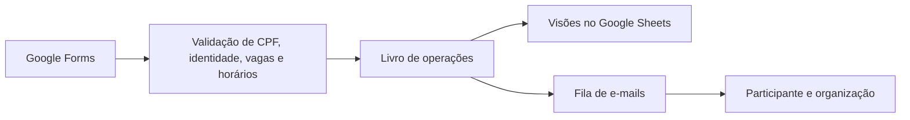

<div align="center">

# SEMINFO

### Inscrições organizadas. Vagas controladas. Programação em um só lugar.

Sistema de inscrições da **XXI Semana da Informática**.<br>
Google Forms · Google Sheets · Google Apps Script


**26 a 29 de outubro de 2026** · Centro Acadêmico Alan Turing

[Instalação](#instalação) · [Uso](#uso) · [Estrutura](#estrutura) · [Testes](#testes) · [Documentação](#documentação)

</div>

---

O SEMINFO conecta os formulários do evento a uma planilha central. Cada solicitação passa por validação de identidade, CPF, disponibilidade e conflito de horário. O participante recebe o resultado por e-mail, e a organização acompanha inscrições, equipes e ocupação pelo menu **SEMINFO**.

O projeto inclui **11 Forms por ID e 2 novos Forms por URL pública**, o Form histórico da CSP e os **18 itens da programação final**, incluindo a oficina de C com 40 vagas. A preparação resolve os IDs de edição dos novos Forms na conta instaladora. Títulos visíveis e nomes dos arquivos usam **PALESTRA - Nome da atividade** ou **OFICINA - Nome da atividade**. A CSP continua no fluxo de importação por equipes. Atividades com informações incompletas aparecem como **pendentes** e recebem inscrições depois que seus dados forem completados e a abertura for autorizada.

## O que o sistema faz

| Recurso | Comportamento |
|---|---|
| Inscrições | Vários Forms compartilham o mesmo controle de CPF e identidade. |
| Vagas | A ocupação considera inscrições confirmadas, com processamento sob bloqueio. |
| Horários | Sobreposições são verificadas entre todas as atividades do participante. |
| Trocas | Uma troca autorizada substitui as inscrições conflitantes somente quando há vaga. |
| Cancelamentos | O participante usa um Form; a organização também pode cancelar com justificativa. |
| Equipes CSP | A capacidade pode ser contada por equipe, com integrantes identificados. |
| E-mails | Fila persistente com novas tentativas; o CA recebe avisos de problemas e lotação. |
| Administração | Cadastro, exclusão de atividades sem inscrições, exportação e recuperação das visões. |

## Como funciona



`Operacoes` guarda as decisões oficiais. As abas de consulta são reconstruídas a partir desse livro; as respostas brutas do Forms permanecem separadas das inscrições confirmadas.

## Instalação

**Você precisa de uma conta Google com acesso aos Forms e à planilha, um projeto Apps Script e a Google Forms API habilitada.** O sistema usa os formulários nativos; a instalação não exige publicar um aplicativo web.

1. Abra a planilha central e acesse **Extensões → Apps Script**.
2. Crie os **sete arquivos `.gs`** com os nomes de [`src/`](src), colando o conteúdo completo de cada arquivo no correspondente. Todos pertencem ao **mesmo projeto**.
3. Habilite a exibição do manifesto nas configurações do projeto e use [`src/appsscript.json`](src/appsscript.json). O fuso é `America/Sao_Paulo`.
4. Confira os IDs e o e-mail da organização em [`src/Config.gs`](src/Config.gs). Habilite a **Google Forms API** no projeto Cloud associado.
5. Execute `instalarSistema` com a conta que ficará responsável pelo sistema e autorize as permissões.
6. Execute `configurarEmailVerificadoFormularios` para definir **Coletar endereços de e-mail → Verificado** em todos os Forms configurados, ou escolha essa opção manualmente em cada Form. Confira o acesso dos participantes.
7. Execute `atualizarProgramacaoSeminfo2026` para integrar os Forms e cadastrar a programação. Complete as pendências, confira o sistema e use **Abrir inscrições** quando estiver pronto.

> Os arquivos mantêm a configuração do evento. Depois da instalação, os valores persistidos são lidos da aba `Configuracoes`; mudar os padrões do código não substitui automaticamente essa configuração.

O passo a passo da API, permissões, publicação dos Forms e recuperação está no [manual completo](docs/MANUAL.md).

### Qual conteúdo vai em cada arquivo?

| Arquivo em `src/` | Responsabilidade |
|---|---|
| [`Config.gs`](src/Config.gs) | `SEMINFO_CONFIG`, tabelas, configurações, bloqueio e acesso à planilha. |
| [`Domain.gs`](src/Domain.gs) | Regras de CPF, identidade, atividades, vagas, conflitos e equipes. |
| [`Persistence.gs`](src/Persistence.gs) | Livro oficial, processamento e reconstrução das visões. |
| [`Forms.gs`](src/Forms.gs) | Integração com Forms, perguntas, identidade e opções. |
| [`Notifications.gs`](src/Notifications.gs) | Fila e modelos de e-mail, cotas e novas tentativas. |
| [`Admin.gs`](src/Admin.gs) | Menu, instalação, programação e administração. |
| [`Importacao.gs`](src/Importacao.gs) | Prévia e importação administrativa das inscrições anteriores da CSP. |

## Uso

Depois de reabrir a planilha, o menu **SEMINFO** reúne as ações de operação.

| Objetivo | Função |
|---|---|
| Atualizar Forms e acrescentar a programação, preservando inscrições | `atualizarProgramacaoSeminfo2026` |
| Aplicar os novos títulos aos Forms e atividades existentes | `atualizarFormularios` |
| Cadastrar ou atualizar uma atividade | `salvarAtividade` |
| Excluir uma atividade sem inscrições no histórico | `apagarAtividade` |
| Conferir configurações, gatilhos e cotas | `conferirSistema` |
| Abrir ou encerrar inscrições | `abrirInscricoes` / `encerrarInscricoes` |
| Consultar ocupação | `consultarOcupacao` |
| Exportar uma lista de confirmados | `exportarConfirmados` |
| Recuperar as abas de consulta | `reconstruirVisoes` |

**Atualizar a programação** aplica os nomes, ministrantes, salas, horários e capacidades finais em `Atividades` e `Programacao`, incorpora os novos Forms e atualiza títulos e descrições. A migração mantém inscrições e registra a mudança no livro oficial; recusa o lote se uma capacidade ficar abaixo da ocupação ou os novos horários causarem conflitos. Consulte o [roteiro da programação final](docs/PROGRAMACAO_FINAL.md) para aplicar a atualização existente e conferir pendências.

**Começar do zero** é uma operação separada: `comecarSeminfo2026DoZero` apaga os dados operacionais, limpa as respostas dos Forms de inscrição/cancelamento e mantém as respostas do Form histórico da CSP para permitir sua importação após o reinício. Cria backups ocultos e carrega a programação novamente. Os IDs, links e perguntas dos Forms são mantidos. Consulte o [guia de reinicialização](docs/COMECAR_DO_ZERO.md) antes de usar essa função.

## Programação do evento

| Data | Programação de referência |
|---|---|
| **26/10 · Segunda-feira** | Das 13h às 17h: credenciamento, palestra de Douglas e coffee break, no Auditório Novo. Às 19h: Troubleshooting e dados no mundo real, com Ana Carolina Brazão, via Google Meet. |
| **27/10 · Terça-feira** | GameMaker (tarde e noite), Pipeline de Dados, Blender (20 vagas), Ollama, IA Além do Chat, Introdução à linguagem C (40 vagas) e palestra ABREU às 13h30. |
| **28/10 · Quarta-feira** | Oficina Segurança da Informação e palestra online de Daniele Tavares. |
| **29/10 · Quinta-feira** | CSP das 13h às 15h30; encerramento das 15h30 às 17h; palestra online de Johnatan Alves de Oliveira às 19h30. |

Os dados de referência estão em [`data/`](data):

- [Programação e pendências](data/PROGRAMACAO_SEMINFO_2026.json).
- [Cadastros das atividades](data/ATIVIDADES_SEMINFO_2026.json).
- [Forms, nomes e vínculos](data/FORMULARIOS_SEMINFO_2026.json).
- [Novos Forms por URL pública](data/FORMULARIOS_PUBLICOS_SEMINFO_2026.json).
- [Configuração da importação de equipes CSP](data/CONFIG_IMPORTACAO_CSP_EQUIPES.json).

## Estrutura

```text
seminfo-inscricoes/
├── src/                    # Sete módulos .gs e manifesto do Apps Script
├── data/                   # Programação, atividades e configuração dos Forms
├── docs/                   # Manual, reinicialização e homologação
├── tests/                  # Testes locais com serviços Google simulados
├── scripts/
│   └── build_delivery.py   # Validação e geração do pacote
├── .gitattributes          # Padronização de arquivos de texto
├── .gitignore              # Artefatos e configurações locais fora do Git
└── README.md
```

A pasta `dist/` é criada pelo empacotamento e fica fora do versionamento.

## Testes

As quatro suítes usam **Node.js**, sem dependências externas. Execute na raiz do projeto:

```sh
node tests/domain.test.cjs
node tests/notifications.test.cjs
node tests/forms-install.test.cjs
node tests/persistence.test.cjs
```

Elas cobrem regras de inscrição, múltiplos Forms, programação, equipes, notificações, concorrência simulada, falhas de gravação e retomada da limpeza. O resultado detalhado e o roteiro de homologação estão em [docs/TESTES.md](docs/TESTES.md).

Os serviços Google são simulados nos testes locais. A publicação, as permissões, a entrega de e-mails e os gatilhos reais precisam ser conferidos na conta do evento.

### Gerar o pacote de entrega

Com **Python 3** e **Node.js** disponíveis:

```sh
python -X utf8 scripts/build_delivery.py
```

O comando valida a sintaxe, executa as suítes, atualiza os JSONs de referência e gera em `dist/` o ZIP do projeto, a entrega integral, os exemplos de cadastro e o relatório dos testes. O ZIP contém os fontes, dados, documentação e testes; a pasta `dist/` fica fora dele.

## Documentação

| Guia | Conteúdo |
|---|---|
| [Manual completo](docs/MANUAL.md) | Instalação detalhada, configuração, operação, persistência e recuperação. |
| [Começar do zero](docs/COMECAR_DO_ZERO.md) | Limpeza, backups, retomada e manutenção dos Forms. |
| [Testes e homologação](docs/TESTES.md) | Evidências locais e verificações necessárias no Google. |
| [Notificações](docs/NOTIFICACOES.md) | Conta remetente, fila de e-mails e limites operacionais. |

---

<div align="center">

**XXI SEMINFO · Centro Acadêmico Alan Turing**<br>
Organização e controle das inscrições da Semana da Informática.

</div>

Para aplicar os novos títulos nos Forms já integrados, copie `Config.gs` e `Admin.gs` atualizados para o Apps Script, salve e reabra a planilha. Use **SEMINFO → Atualizar nomes dos formulários** (ou execute `atualizarFormularios`). O título visível e o arquivo no Drive usam `PALESTRA - Nome da atividade` ou `OFICINA - Nome da atividade`, preservando respostas, inscrições, horários e vagas. Para também incorporar o Form de linguagem C à instalação, atualize os arquivos `.gs` do pacote e execute `atualizarProgramacaoSeminfo2026`.

A atualização também renomeia os arquivos dos Forms no Drive e as abas de respostas vinculadas. Copie também `src/appsscript.json` para o manifesto do projeto e autorize o acesso de edição ao Drive solicitado na próxima execução.
